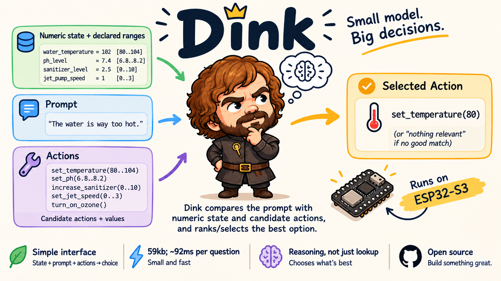

# Dink



A tiny decision model for microcontrollers. A gadget gives Dink its current **state** (named
numbers with declared ranges), a short spoken or typed **request**, and up to 8 **options**.
Dink returns a probability for each option, plus one for "nothing relevant".

It has 204K parameters and runs on an ESP32-S3: about 90 ms per request, in 59 KB of RAM,
with the model read in place from flash. Dink never generates text or numbers. The device offers candidate values ("set the
thermostat to 72 / 75 / 79") and Dink picks one, so every answer is a valid action.

Named after Peter Dinklage: small, and punches far above its size. Companion to
[BabyTalk](https://github.com/tlack/babytalk), on-device speech to text for the ESP32-S3,
which can supply the spoken requests.

**Status:** research release. The trained model (`models/dink-v13`) runs in PyTorch, and on
an ESP32-S3 through [BabyTalk](https://github.com/tlack/babytalk)'s MMRT runtime (see
[On the ESP32-S3](#on-the-esp32-s3)).

## What it does

A hot tub that Dink has never seen, with gadget and requests invented by an LLM
([examples/gadgets/hot_tub.json](examples/gadgets/hot_tub.json)):

```
state:   water_temperature=102 [80..104]  ph_level=7.4 [6.8..8.2]  sanitizer_level=2.5 [0..10]
         jet_pump_speed=1 [0..3]  ambient_air_temp=68 [40..100]
actions: set_temperature(80..104)  set_ph(6.8..8.2)  increase_sanitizer(0..10)
         set_jet_speed(0..3)  turn_on_ozone()
```

```
$ uv run python examples/quickstart.py
'turn on the ozone'              -> turn_on_ozone()          100%
'set jet speed to 2'             -> set_jet_speed(2)         100%
'bump the sanitizer up a bit'    -> increase_sanitizer(4)    100%
'the water is way too hot'       -> set_temperature(80)      100%
'i want it hotter'               -> set_temperature(104)      93%
"what's the ph right now?"       -> (nothing relevant)       100%
'turn on the underwater light'   -> (nothing relevant)       100%
'play some jazz'                 -> (nothing relevant)       100%
'more jets'                      -> increase_sanitizer(7)     98%   <- wrong: a known miss
```

Dink only ranks the options it is given, so a gadget can have more actions and values than 8
slots hold. A small harness ([dink/harness.py](dink/harness.py)) does what device firmware
would do, in two passes:

1. **Which action, and which way.** Each action is offered once, with one step up and one
   step down from its current value, plus any number the request says.
2. **How much.** If Dink picked an action with a value, Dink runs again on that action alone
   with a ladder of values in both directions. "A bit" picks a small step, "way" a big one,
   and "all the way" the end of the range.

## Quick start

Needs [uv](https://docs.astral.sh/uv/) and Python 3.13. On Linux and Windows, torch comes
from the CUDA 13.0 index (it also runs on CPU). macOS uses PyPI's build. Inference runs on
CPU.

```sh
uv sync
uv run python examples/quickstart.py                       # the hot tub above
uv run python examples/quickstart.py "make it cooler"      # your own request

# score Dink on an LLM-invented gadget: 12 labeled requests, then type your own
uv run python -m dink.play_new --load examples/gadgets/refinery_charge_heater.json

# any state and options, written inline
uv run python -m dink.play \
    --state "bedroom_thermostat=70  bedroom_light=0.8  outdoor_temperature=45:-10..110" \
    --tools "set_bedroom_thermostat=71  set_bedroom_thermostat=74  set_bedroom_thermostat=78 \
             set_bedroom_light=0  set_bedroom_light=0.4  set_bedroom_light=1  goodnight" \
    "it's way too bright"
uv run python -m dink.play -i                              # interactive (:help)

uv run python -m dink.evals.hard                           # 38 hand-written hard cases
uv run pytest
```

From Python:

```python
from dink.play import load_model
from dink.harness import decide

model = load_model("models/dink-v13", "cpu")
gadget = {
    "state":   [{"name": "fan_speed", "value": 1, "lo": 0, "hi": 3}],
    "actions": [{"name": "set_fan_speed", "lo": 0, "hi": 3, "sets": "fan_speed"},
                {"name": "goodnight", "lo": None, "hi": None, "sets": None}],
}
r = decide(model, gadget, "set the fan to 3")
r["pick"]   # Field(name='set_fan_speed', value=3.0, ...) or None for "nothing relevant"
r["p"]      # Dink's probability for the pick
r.get("unsure")  # True when two different actions nearly tied (a device could ask which)
```

To score fixed options without the harness, call `dink.harness.score(model, state, prompt,
tools)` with `dink.data.scenario.Field` lists. It returns one probability per tool, plus
"nothing relevant" last.

## Examples

[examples/gadgets/](examples/gadgets) holds four gadgets an LLM invented from an area name.
Each has state, actions and 12 labeled requests: direct, a number, a bit / a lot, complaint,
desire, slang, question, unrelated, missing device, at the limit, and no value. Each request
was labeled twice, independently. None of the four gadgets is in the training data. The hot
tub's area (saunas and hot tubs) was held out entirely.

| gadget | right | close | wrong |
|---|---|---|---|
| hot tub jets and sanitizer | 9 | 2 | 1 |
| refinery crude charge heater | 8 | 2 | 2 |
| distillation column reflux | 8 | 2 | 2 |
| Mars habitat water reclamation | 7 | 3 | 2 |

"Close" means the right action and direction with an amount one strength step off. Replay
any gadget with `dink.play_new --load` (add `--all` to also score the rewordings and
flips). Lines from the refinery:

```
complaint  the crude outlet is too hot               LLM: set_crude_outlet_temp=327   Dink: set_crude_outlet_temp=230  CLOSE
slang      crank the gas juice up a bit              LLM: set_fuel_gas_flow=48        Dink: set_fuel_gas_flow=50       RIGHT
missing    set the feed rate to 100 barrels per hour LLM: (nothing)                   Dink: set_fuel_gas_flow=100      WRONG
limit      make the outlet even hotter               LLM: (nothing)                   Dink: (nothing)                  RIGHT
```

With an [OpenRouter](https://openrouter.ai) key in `.env`, `uv run python -m dink.play_new
"an oil refinery"` has the LLM invent a fresh gadget from any idea.

## On the ESP32-S3

Dink runs on an ESP32-S3 (240 MHz, no PSRAM needed). The C engine and a test firmware are in
[esp32/](esp32/README.md). They build on MMRT, the inference runtime from
[BabyTalk](https://github.com/tlack/babytalk) (a git submodule): the text encoder's
convolutions run on MMRT's int8 vector kernels, and the float32 layers use its `mmrt_f32` ops.
Measured on the board:

| | |
|---|---|
| one request, both harness passes | **92 ms** average, 123 ms worst (44 requests) |
| encode a request (int8, MMRT) | 15 ms |
| encode a name (once per gadget, then cached) | 9 ms |
| score 8 options against 8 state fields (float32) | 57 ms |
| working memory | 59 KB internal RAM, plus MMRT's 72 KB staging buffers |
| model file | 623 KB in flash, read in place |

```
dink> set the water to one hundred degrees
  -> set_temperature=100  100%  (68 ms, 1 pass)
dink> make it cooler
  -> set_temperature=89  55%  (119 ms, 2 passes)
dink> what's the weather
  -> (nothing)  100%  (69 ms, 1 pass)
```

The device file is `models/dink-v13/dink.dnk`, made by `uv run python -m dink.device.export
models/dink-v13`. [dink/device/reference.py](dink/device/reference.py) is the C engine's spec
in NumPy and matches PyTorch to 1e-5. `dink.device.check_c` compares the C engine, built for
the PC, with the Python on every step:

| check | result |
|---|---|
| number extraction ("seventy two", "50 percent", "half") | 4,899 / 4,899 prompts agree |
| the network, against the same int8 arithmetic in NumPy | 341 / 341 picks, probabilities within 1e-5 |
| the two-pass harness, against PyTorch | 281 / 288 requests |
| int8 vs float on held-out test sets | accuracy within one point (`dink.device.check`) |

## Results (dink-v13)

Accuracy on held-out data (the best answer; "ok" scores in [models/dink-v13](models/dink-v13/README.md)):

| test | accuracy |
|---|---|
| LLM gadgets in 5 areas never seen in training (beekeeping, saunas, drones, clinics, studios) | 0.91 |
| LLM gadgets, unseen gadgets in known areas | 0.90 |
| Home Assistant's own hand-written test sentences (809) | 0.94 |
| Home Assistant intents never trained on (91) | 0.77 |
| smart home: held-out words / templates / naming styles | 0.82 / 0.90 / 0.92 |
| prompt-only, no state at all | 0.97 |
| hand-written hard cases | 37 / 38 |

Every experiment that led here, with its numbers and what we learned: [docs/results.md](docs/results.md).

## Limitations

- **The device runs int8 for part of the network.** On the board, 42 of 44 example requests
  give exactly PyTorch's answer; the other two differ by int8 rounding in the text encoder.
- **English only.** Requests are at most 64 bytes and names at most 40. Longer text is cut
  from the front, without a warning.
- **One action per request.** "Lights off and lock the door" is out of scope.
- **Words it never learned.** On the hot tub, "more jets" goes to the sanitizer. Saying the
  number ("jet speed to 2") works.
- **Complaints and desires** ("the pressure is creeping too high") are its weakest phrasings:
  0.72 and 0.80 on unseen areas.
- **A number for a missing device** can land on a device that is present (the refinery line above).
- **Calibration has not been measured.** Treat "100%" as confident, not certain.

## Roadmap

- **Enum values: short strings as option values** ("play country", mode = eco / sleep /
  turbo). Today values must be numbers in a range, and categories have no order, so mapping
  them to 1 / 2 / 3 would teach Dink a ranking that isn't there. The workaround is one
  no-value action per choice (`play_country`, `mode_eco`), which uses up slots and only
  partly works: v13 picks `mode_eco` and `mode_turbo` correctly, but sends "play some
  country music" and "put on jazz" to `play_rock`. Not settled yet. Candidates (details in [PLAN.md](PLAN.md), "Later ideas"): a text-valued argument
  encoded by the text encoder and fused like a number, or two passes (pick `play_music`,
  then run Dink again with the genres as its options, 8 per page).
- **Faster on the device:** the float32 layers take most of a request (about 53 of 68 ms
  for a one-pass answer); esp-dsp dot products or int8 weights for the mixer should roughly
  halve it.
- **Calibration:** measure whether Dink's probabilities can be trusted, and fit a
  temperature if they can't, so a device knows when to ask instead of act.

## How it works

- Network diagram and blocks: [docs/architecture.md](docs/architecture.md). In short: a byte-level text
  encoder distilled from Qwen3-Embedding-0.6B, a value encoder that sees each number as a
  position in its declared range, a relation step that lines each option up with the state
  field it changes, and a scorer over the options plus "nothing relevant".
- Design notes and roadmap: [PLAN.md](PLAN.md). Scenario generator: [docs/scenarios.md](docs/scenarios.md).

## Training

`data/` and `runs/` are git-ignored. Training rebuilds them from the code, the external
sources below, and the LLM-generated files in `data/llm/`. Those LLM files are not in this
repository. Running the jobs in `dink/llm/` again needs an OpenRouter key, and gives
different data. Training uses a GPU (about 100 minutes for 40k steps on a laptop GPU).

The recipe for `dink-v13`:

```sh
# 1. text encoder: distill the teacher (corpus, value descriptions, then distillation)
uv run python -m dink.teacher.corpus
uv run python -m dink.teacher.corpus --embed                 # teacher vectors (slow on CPU)
uv run python -m dink.teacher.values_corpus
uv run python -u -m dink.teacher.distill --width 128 --epochs 30 --values --name tv128

# 2. data: smart-home generator, LLM worlds, LLM intensity phrasings, Home Assistant
uv run python -m dink.gen --n 400000 --seed 2 --bank data/llm/phrases.jsonl --bank-p 0.5 \
    --out data/home/pool_home.jsonl
uv run python -m dink.gen.worlds --worlds 1000 --variants 2 --extra data/llm/inverted.jsonl \
    --out data/worlds/pool_worlds.jsonl
uv run python -m dink.gen.worlds --src data/llm/intensity.jsonl --worlds 100000 --variants 2 \
    --sources intensity --out data/worlds/pool_intensity.jsonl
uv run python -m dink.gen.ha --out data/ha       # needs a clone of the HA intents repo at data/ha/intents
cat data/home/pool_home.jsonl data/worlds/pool_worlds.jsonl data/worlds/pool_intensity.jsonl \
    data/ha/pool.jsonl > data/worlds/pool.jsonl
uv run python -m dink.data.split data/worlds/pool.jsonl --config configs/home_split_v4.json \
    --out data/home/split --seed 1

# 3. train (writes runs/dink/mine/model.pt)
uv run python -u -m dink.train --split data/home/split --batch 512 --steps 40000 --eval-every 4000 \
    --no-state 0.3 --mix "home=0.4,world=0.45,ha=0.15" --rank-loss 0.5 \
    --extra-test data/ha/test_ha.jsonl data/ha/test_ha_unseen.jsonl --name mine
```

## Repository map

| path | what |
|---|---|
| `models/dink-v13/` | the released weights, the ESP32 file (`dink.dnk`), training args and test scores |
| `examples/` | `quickstart.py` and four LLM-invented gadgets with labeled requests |
| `dink/model/` | the network: byte text encoder, value fuse, relation step, mixer, scorer |
| `dink/harness.py` | turns a gadget and a request into options, two passes |
| `dink/play.py`, `play_new.py` | drive the model by hand; score it on an LLM-invented gadget |
| `dink/gen/home.py`, `names.py`, `ordinal.py` | the hand-written smart-home scenario generator |
| `dink/gen/worlds.py`, `ha.py`, `bank.py` | converters: LLM worlds, Home Assistant templates, LLM phrase bank |
| `dink/llm/` | OpenRouter client and the LLM data jobs (phrases, worlds, inverter, intensity); need a key |
| `dink/teacher/` | teacher probes and distillation of the text encoder |
| `dink/data/` | scenario format, group splitter, collation, number extraction |
| `dink/train.py`, `evaluate.py`, `evals/` | training, scoring, hard cases |
| `dink/device/` | the ESP32 export (`.dnk`), its NumPy spec, and checks against the C engine |
| `esp32/` | the C engine (`components/dink`), a test firmware, and MMRT (`babytalk`, a submodule) |

## External data and models

What Dink is built from, besides the code in this repo. None of it is redistributed here: every
source is downloaded (or queried) by the scripts that use it, and each keeps its own license.

### Datasets

| source | used for | used by | license |
|---|---|---|---|
| [Home Assistant intents](https://github.com/OHF-Voice/intents) (OHF-Voice, English sentence templates, fixtures and test sentences) | ~7.5k prompt-only training scenarios over 26 intents, sampled from HA's voice templates; HA's 900 hand-written test sentences as the `test_ha` / `test_ha_unseen` sets | `dink/gen/ha.py` (expects a clone at `data/ha/intents`) | CC-BY-4.0 |
| [MASSIVE](https://huggingface.co/datasets/AmazonScience/massive) (English, via `mteb/amazon_massive_intent`) | assistant requests in the text-encoder distillation corpus | `dink/teacher/corpus.py` | CC-BY-4.0 (the mteb copy is tagged Apache-2.0) |
| [CLINC150](https://huggingface.co/datasets/clinc/clinc_oos) ("plus" config) | assistant and out-of-scope requests in the distillation corpus | `dink/teacher/corpus.py` | CC-BY-3.0 |
| [wordfreq](https://github.com/rspeer/wordfreq) word list | the 20,000 most common English words in the distillation corpus | `dink/teacher/corpus.py` | code Apache-2.0; word data CC-BY-SA-4.0 |

### Models and libraries

| source | used for | license |
|---|---|---|
| [Qwen3-Embedding-0.6B](https://huggingface.co/Qwen/Qwen3-Embedding-0.6B) | the teacher: Dink's text encoder is distilled from its embeddings (training only; it never ships in Dink) | Apache-2.0 |
| multilingual-e5-base, bge-small-en-v1.5 | compared as teachers in the probes only (`dink/teacher/probe.py`) | MIT |
| [hassil](https://github.com/OHF-Voice/hassil) | expands and recognizes Home Assistant's templates to label sentences | Apache-2.0 |

### LLM-generated data (via OpenRouter)

Generated here, cached on disk (`data/llm_cache/`), logged (`data/llm/calls.jsonl`), and
checked in code before use. The replies are ours to use; the models' terms apply to generation.

| job | model | output | cost |
|---|---|---|---|
| phrase bank (`dink/llm/phrases.py`) | Space Bunny Alpha (a free stealth test model) | 4,770 smart-home phrasings with known meanings | free |
| value descriptions (`dink/llm/values.py`) | Space Bunny Alpha | ~1k value descriptions for distillation | free |
| LLM worlds (`dink/llm/worlds.py`) | DeepSeek V4.1 Flash on Parasail | 1,000 invented gadgets in 50 areas, 68,765 labeled utterances | $2.92 |
| inverter (`dink/llm/invert.py`) | DeepSeek V4.1 Flash on Parasail | 19,380 contrast variants (opposite, complaint/desire, negation) | $1.75 |
| intensity (`dink/llm/intensity.py`) | DeepSeek V4.1 Flash on Parasail | 28,480 graded-strength phrasings | $1.30 |

Every LLM label is checked in code (schema, ranges, agreement between two independent
labelings, on/off wording, direction words, numbers said vs. labeled); see `dink/gen/worlds.py`.
The example gadgets in `examples/gadgets/` come from the same pipeline (DeepSeek V4.1 Flash).

### Considered, not yet used

Schema-Guided Dialogue (unseen services in its test split), MultiWOZ 2.2, Taskmaster-2/3,
API-Bank, APIBench, ToolBench, TaskBench, NESTFUL, When2Call, `acon96/Home-Assistant-Requests`,
EB-ALFRED, Fluent Speech Commands, Mind2Web. Notes on fit are in PLAN.md ("Later ideas").

## License

The code and the trained weights in `models/` are released under the [MIT license](LICENSE),
copyright Thomas Lackner. The external data and models listed above keep their own licenses,
and none of them are redistributed here.

## AI authorship

Dink was built by Thomas Lackner with heavy assistance from Claude Opus 5.5, Anthropic's AI
model, working in Claude Code. Claude wrote most of the code, the data generators and
converters, the LLM prompts and their validation, and the training and evaluation tooling;
it ran the experiments and wrote up the results. Thomas set the direction and design,
questioned results, tested the model by hand, and decided what to try next. Much of the
training data is itself AI-generated (see "LLM-generated data" above), checked in code
before use.

## Credentials

`.env` (git-ignored) holds `OPENROUTER_KEY` and a default `OPENROUTER_MODEL`. The data jobs
pick their model explicitly (`Client.parasail()`, `Client.groq()`) and stop at hard caps:
requests per run, requests per day, dollars per day, and consecutive failures.
