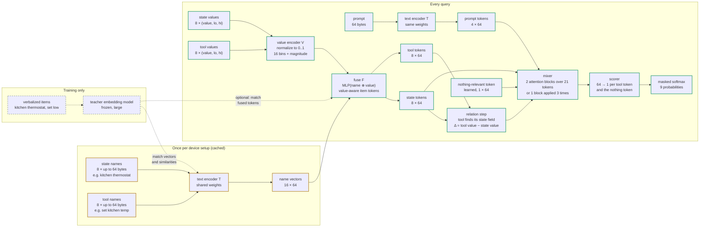

# Dink architecture (v1)

Colors: amber = computed once per device setup and cached; green = every query;
dashed grey = training only. The same diagram, with block internals and cost estimates,
is published as a page ("Dink network graph").

## Blocks

| block | what it does | when |
|---|---|---|
| text encoder T | bytes → embed 32 → 1×1 conv 32→128 → [depthwise k5 + 1×1 128→128] × 2 → attention pooling (4 prompt tokens, or 1 vector per name) | names once per setup (cached); prompt every query |
| value encoder V | (value, lo, hi) → normalized 0..1 → 16 piecewise-linear bins + signed log magnitude + has-value = 18 features | every query |
| fuse F | [name vector 64 ⊕ value features 18] → 128 → 64: value-aware item tokens ("thermostat, set low") | every query |
| relation step | each tool attends over state name vectors, takes the matching field's value, Δ = tool value − state value → bins → added to the tool token | every query |
| prompt numbers | numbers extracted from the prompt (2-3 slots, with a unit hint: raw or percent) are compared with each tool in that tool's own range: in range?, level, distance to the candidate value, exact match → added to the tool token | every query |
| mixer | 21 tokens × 64 (8 state + 4 prompt + 8 tool + nothing); 2 blocks of 4-head attention + FFN 64→256→64, or 1 block applied 3 times | every query |
| scorer | 64 → 1 per tool token and the nothing token; masked softmax over filled slots | every query |

Estimates: ~190 K parameters, ~6 M multiply-adds per query (~10 ms on the ESP32-S3).

## Drawing the real graph later

This diagram is the design. Once the PyTorch model exists, `torchview` can draw the
graph straight from the code (and Netron from the exported model), so the picture can
be checked against what is actually built.
